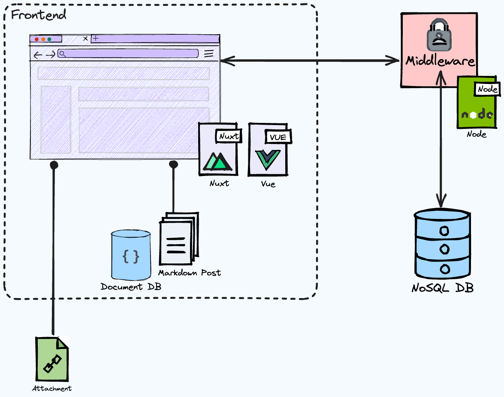

# Frontend Sito Mirandola 2 ⚜️

> ℹ️ _Il ruolo di questo file è duplice: in primis funge da documentazione per coloro che hanno creato sviluppato il sito ma hanno altresì scarsissima memoria. In secondo luogo vuole essere, anche e soprattutto, una sorta di guida per chi a prescindere dalle proprie competenze vorrebbe_ capirci qualcosa _ed è curioso di cosa tiene in piedi il “frontend” del sito del Mirandola 2. Per questa duplice natura - e nell'ottica del principio scout del Trapasso Nozioni - si è cercato di usare un linguaggio chiaro e spiegare cose che per alcuni possono essere ovvie pur sapendo che d'altra parte per forza di cose questo non potrà bastare a capire tutto tutto. Sicuramente è meglio di niente; se vorrete leggerlo, buona caccia!_

Il frontend è la parte di un sito web che è visibile dall'utente. Nel nostro caso è stata costruita usando Next.js e Tailwind. Quest'ultimo è un framework CSS utilizzato insieme alla libreria Daisy UI per semplificare la parte di design del sito. Next.js è invece un framework JavaScript (in questo progetto scritto in TypeScript) che permette di costruire siti, anche statici, utilizzando **React**. Le icone del sito vengono dalla libreria [Phosphor Icons](https://phosphoricons.com/).

I siti statici, come quello generato da Next.js con l'opzione `output: 'export'`, sono siti web precompilati in pagine HTML, CSS e JavaScript che non richiedono un server attivo per generare i contenuti al momento della richiesta dell’utente. A differenza dei siti tradizionali dinamici, che generano le pagine in tempo reale, i siti statici vengono generati in anticipo, permettendo una distribuzione più semplice e una performance più elevata.

Di seguito si può vedere l'architettura del sito.



In questa repository è presente e qui documentato il frontend, mentre il [Middleware 📤 si può trovare qui](https://github.com/mirandola2/middleware).

#### Indice
- [Introduzione](#frontend-sito-mirandola-2-)
   * [Local development 🪄](#local-development-)
   * [Content update ✏️](#content-update-)
      + [MDX syntax](#mdx-syntax)
         - [Cards & card](#cards--card)
         - [Table of contents](#table-of-contents)
         - [Figures](#figures)
            * [Caroselli](#caroselli)
            * [Immagini nel testo](#immagini-nel-testo)
         - [Quoted](#quoted)
         - [Staff](#staff)
         - [Button Link](#button-link)
         - [Altri componenti](#altri-componenti)
      + [Front Matter](#front-matter)
      + [Menu](#menu)
   * [Staff file 👨‍👩‍👧‍👧](#staff-file-)
   * [Immagini 🖼️](#immagini-)
   * [Analytics 📊](#analytics-)
   * [Hosting ☁️](#hosting-)


## Local development 🪄

Per far partire il local server (su [http://localhost:3000](http://localhost:3000)):

```sh
npm install
npm run dev
```

Per generare il sito statico (nella cartella `out/`, insieme alla sitemap):

```sh
npm run build
```

Pushando le modifiche su Github, il sito verrà automaticamente aggiornato.

## Content update ✏️

> __Premessa__: Questo paragrafo vuole essere d'aiuto per chiunque voglia modificare il sito senza avere particolari rudimenti su [Next.js](https://nextjs.org/) o React. Logicamente non si è potuto inserire tutto lo scibile sull'argomento; perciò si rimanda il lettore alla documentazione ufficiale nel caso si volessero fare modifiche più profonde al sito.

I contenuti del sito sono renderizzati a partire da file presenti in due fonti:

- la cartella `content` ospita le pagine in formato [MDX](https://mdxjs.com/), ovvero [Markdown](https://markdownguide.org/cheat-sheet/) a cui si possono aggiungere componenti. Ogni file `.mdx` diventa automaticamente una pagina con lo stesso percorso (es. `content/eg/brownsea.mdx` → `/eg/brownsea`, `content/lc/index.mdx` → `/lc`). I file che iniziano per `_` non diventano pagine: sono file particolari con funzioni specifiche (contenuti della home e file `.csv`).
- la cartella `app` ospita le pagine scritte direttamente in React (la home, il blog, l'archivio totem) oltre che il template standard delle pagine al punto precedente (`app/[...slug]/page.tsx`). I componenti usati da queste pagine si trovano nella cartella `components`.

I contenuti nella carta __"In primo piano"__ presente nella home sono invece modificabili dal file `content/_home.mdx`.

I singoli articoli della sezione blog sono anch'essi pagine MDX, presenti nella cartella `content/blog`.

Essendo il Markdown un linguaggio estremamente comodo, si è preferito usare il più possibile la cartella `content`, lasciando nei file React solamente ciò che era troppo complesso per essere scritto in Markdown.

Si noti infine che le immagini **non** si trovano nella cartella `public`, ma su ImageKit (vedi [Immagini](#immagini-)). Si è cercato di caricare solo le immagini principali, compresse il più possibile, tenendo sempre a mente il fatto che la maggioranza di esse nonché i file esterni, è meglio caricarli su altri cloud (Google Photos, One Drive, Google Drive etc.). Quando vengono linkate le immagini nelle varie pagine, il percorso è relativo alla cartella radice di ImageKit (es. `/img/misc/img.jpg`).

### MDX syntax

Le pagine nella cartella `content` sono in formato MDX, ovvero un markdown "potenziato" che permette di inserire componenti React con una sintassi simile all'HTML (più info nella [documentazione ufficiale](https://mdxjs.com/docs/what-is-mdx/)).

```mdx
<Componente parametro="valore">
contenuto
</Componente>

<ComponenteSenzaContenuto parametro="valore" />
```

Attenzione: i parametri testuali vanno tra virgolette (`title="Titolo"`), quelli numerici o booleani tra graffe (`float={0}`); un parametro booleano scritto da solo vale `true` (`big`). Inoltre, a differenza del Markdown semplice, caratteri come `<` e `{` nel testo vanno evitati o scritti come `&lt;` e `&#123;`.

I componenti si trovano nella cartella `/components/mdx` e vengono registrati nel file `mdx-components.tsx` (un nuovo componente va aggiunto lì per poterlo usare nelle pagine). Attualmente sono i seguenti.

#### Cards & card

Due componenti da usare insieme, permettono di visualizzare tante _carte_ testuali in modalità galleria. Come si può vedere nell'esempio, il blocco `Cards` contiene le singole `Card`.

```mdx
<Cards>
<Card title="La Legge" color="lc" big>
Il lupetto pensa agli altri come a se stesso.  
Il lupetto vive con gioia e lealtà insieme al branco.
</Card>

<Card title="Il Motto" color="lc">
Del Nostro Meglio
</Card>
</Cards>
```

I parametri di `Card` sono:  

- `title`: stringa, opzionale, sarà visualizzato come il titolo della carta
- `color`: stringa, opzionale (`lc` | `eg` | `rs` | `cc` | `primary` | `base`), rappresenta il colore della carta. Altrimenti sarà di colore neutro (`base`).
- `big`: boolean, opzionale. Se vero, la carta sarà grande il doppio su certi schermi

#### Table of contents

```mdx
<TableOfContents />
```

Fa apparire un indice della pagina nella parte destra della pagina sui dispositivi non mobili, al centro altrimenti. Per far sì che sia a larghezza intera su tutti i dispositivi, è necessario il parametro opzionale `notaside`. Il parametro opzionale `maxdepth` (default `2`) indica fino a quale livello di titoli mostrare.

#### Figures

```mdx
<Fig src="/img/misc/img.jpg" desc="La descrizione dell'immagine" float={1} alt="Immagine di esempio" />
```

Mostra un'immagine formattata usando la grafica del sito; cliccandola si apre a schermo intero. I parametri sono:

- `src` string | string[], obbligatorio: percorso dell'immagine su ImageKit, oppure URL esterno
- `desc` string | string[], opzionale: descrizione che appare sotto all'immagine
- `alt` string, opzionale: testo alternativo per migliorare l'accessibilità ([cos'è?](https://developer.mozilla.org/en-US/docs/Web/API/HTMLImageElement/alt))
- `float` number, opzionale: regola come apparirà l'immagine: `0` la farà apparire centrata e a larghezza ampia, `1` la farà diventare float a sinistra, `2` (default) float a destra.

##### Caroselli

Le proprietà `src` e `desc` possono anche avere più immagini, in modo da creare un carosello. La sintassi deve essere la seguente: 

```mdx
<Fig src={'["/path0.jpg", "/path1.jpg"]'} desc={'["Caption Img 0", "Caption Img 1"]'} />
```

##### Immagini nel testo

Le immagini in Markdown semplice (``) passano anch'esse da ImageKit. Per un link testuale che apre un'immagine a schermo intero si può invece usare `ImageLink`:

```mdx
presso il <ImageLink src="img/misc/box-luca.jpg">Box Luca</ImageLink>
```

#### Quoted

```mdx
<Quoted>
...e quando Hathi, l'elefante selvaggio che vive cento anni e più, vide affiorare una lunga e sottile cresta di Roccia Azzurrina, proprio nel bel mezzo della corrente, capì che quella era la roccia della pace ed immediatamente alzò la proboscide e proclamò la "tregua dell'acqua".  
</Quoted>
```

Il blocco `Quoted` permette di creare una citazione.

#### Staff

```mdx
<Staff staff="L" />
```

Parametri:  

- `staff`: stringa, indica quale staff mostrare [L | C | E | G | N | CF | CC | CJ | *] (rispettivamente, lupetti, coccinelle, esploratori, guide, noviziato, clan-fuoco, coca (altri incarichi), capi gruppo, tutti). 
- `coca`: booleano, opzionale. Se vero, mostra solo i capi in CoCa, con nome e cognome.
- `selector`: booleano, opzionale. Se vero, mostra dei pulsanti per passare da una staff all'altra.

Il blocco mostra tutti i capi di una certa staff. I capi sono inseriti in formato .csv nel file `/content/_capi.csv` rispettando la formattazione presentata in [calce](#staff-file-).


#### Button Link

Mostra il testo di un link all'interno di un bottone, con un'icona opzionale.

```mdx
<Lnk href="https://example.com" icon="checklist">
Testo del Bottone
</Lnk>
```

- `href`: stringa, obbligatorio: il link
- `icon`: stringa, opzionale. Le icone disponibili sono `newspaper`, `movie`, `checklist`, `other_admission`, `center_focus_strong`, `open_in_new` ed `east` (i nomi sono quelli storici di Material Symbols, ora mappati su icone Phosphor). Per aggiungerne una nuova, basta aggiungere una voce al dizionario `icons` in `components/mdx/Lnk.tsx`.
- `self`: booleano, opzionale. I link esterni si aprono in una nuova scheda; con `self` si aprono nella stessa.

#### Altri componenti

Componenti più specifici, usati ciascuno in una sola pagina e senza parametri (se non indicato):

- `<GroupSize />`: mostra i numeri del gruppo (pagina _Il Gruppo_); i numeri sono scritti direttamente in `components/mdx/GroupSize.tsx`
- `<LnkYearGrid />`: griglia per anno di foto e video, letti dal file `/content/_media.csv` (pagina _Foto e Video_)
- `<CodiceSocio lastupdate="2022-23" />`: ricerca del codice socio (pagina _Ricerca Codice Socio_)
- `<Morse />`: traduttore Morse
- `<Alci />`: generatore di alci, con esportazione in PDF
- `<MyDiv>`: semplice contenitore, utile per raggruppare contenuti

### Front Matter

Nei blog post come nelle pagine MDX, esiste una sezione chiamata front matter, scritta in YAML, utile a inserire proprietà e metadati. ([documentazione ufficiale](https://mdxjs.com/guides/frontmatter/)).

Per quanto riguarda le pagine, il front-matter supportato è il seguente.

```md
---
title: "Titolo della pagina"
image: /path/img.jpg # immagine di copertina, usata anche nelle anteprime social
description: "Descrizione per i motori di ricerca" # opzionale
---
```

Per i singoli post presenti nella cartella `content/blog`, invece:  

```md
---
title: "Titolo"
img: '/path/cover.jpg'
category: 'cc' # lc | eg | rs | cc
date: 2023-10-15
description: "Breve descrizione mostrata nell'anteprima del post"
---
```

### Menu

Il menu è gestito nel file `components/navigation.ts`, e in particolare nella lista `menuItems`. Ogni voce ha un'etichetta (`label`) e un link (`href`) oppure una lista di sotto-voci (`children`).

Esempio:

```ts
export const menuItems: MenuItem[] = [
  { label: 'Home', href: '/' },
  {
    label: 'Chi Siamo',
    children: [
      { label: "L'Associazione", href: '/associazione' },
      { label: 'Il Gruppo', href: '/gruppo' },
    ],
  },
]
```

Nello stesso file, la lista `utilityItems` contiene gli strumenti (codice socio, Morse, alci, totem) mostrati nel menu rapido dell'header.

## Staff file 👨‍👩‍👧‍👧

I capi sono inseriti in formato .csv nel file `/content/_capi.csv` rispettando la formattazione presentata nell'esempio seguente.

```csv
nome,nomeCaccia,ruolo,staff,coca,desc,img,order
Baden Powell,Impeesa,Fondatore dello Scoutismo|Capo Reparto,CC|E,1,Impeesa ovvero l'animale che si sposta furtivamente di notte,bp.jpg,0
```

- Il nome mostrato dipende dalla pagina: nelle pagine con `coca` si vedono nome e cognome; nelle pagine L/C (`staff == {L, C}`) solo il `nomeCaccia`, ovvero il personaggio interpretato dai capi in LC (non il nome Totem), in modo da mantenere i capi anonimi ai bambini; nelle altre pagine solo il nome di battesimo.
- Se nel campo `ruolo` è presente una `|`, il contenuto antecedente verrà mostrato quando `staff == *`, il contenuto successivo negli altri casi. 
- Separare i doppi incarichi con un `|` nel campo `staff`. I valori possibili sono gli stessi riportati in precedenza.
- Il campo `img` è il nome della foto del capo, che si deve trovare nella cartella `/img/staff` su ImageKit (se il percorso della foto è `/img/staff/capo.jpg`, il campo deve essere `capo.jpg`).
- Il campo `order` è facoltativo. Se presente, sovrascrive l'ordine delle righe, andando a posizionare i capi secondo l'ordine crescente. Utile solo in caso di doppi servizi.

## Immagini 🖼️

Gestire le immagini è complicato sia per una questione di privacy sia per una questione di storage. L'attuale soluzione prevede che tutte le immagini di archivio siano caricate esternamente, in particolare sul OneDrive fornito al gruppo dall'associazione (i link alle raccolte si trovano nel file `/content/_media.csv`); tranne per ciò che riguarda le poche immagini presenti sul sito come immagini di copertina o simili, che per una questione di latenza si è preferito procedere diversamente. Queste sono caricate sul sito [ImageKit.io](https://imagekit.io), un servizio di CDN che permette di ottimizzare le immagini e renderle più veloci da caricare. 

Grazie al loader personalizzato di `next/image` (`lib/imagekit-loader.ts`) è sufficiente inserire il percorso *relativo* dell'immagine (es. `/img/misc/img.jpg`) e sarà ImageKit a ridimensionarla e ottimizzarla in base allo schermo. Se serve costruire a mano l'indirizzo di un'immagine, va usata la funzione `imagekitUrl` in `lib/imagekit.ts`.

## Analytics 📊
Le statistiche del sito erano gestite dal servizio europeo Simple Analytics, che permette di avere statistiche in tempo reale senza compromettere la privacy degli utenti. Lo script non è ancora stato riportato nella versione Next.js del sito.

## Hosting ☁️

Il sito viene esportato come sito statico nella cartella `out/` (comando `npm run build`) ed è ospitato gratuitamente su [Vercel](https://vercel.com). Il dominio è `mirandola2.it`.
